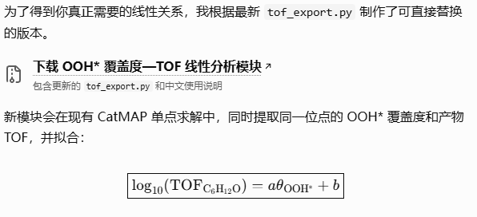
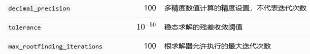
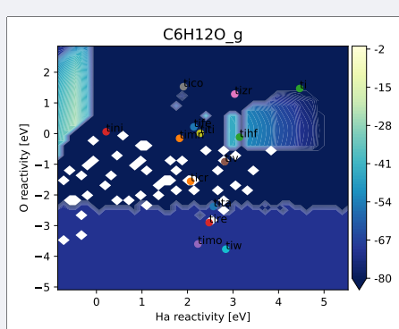
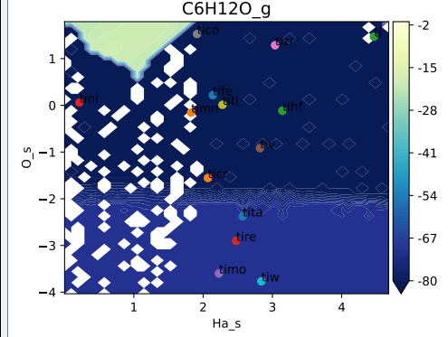
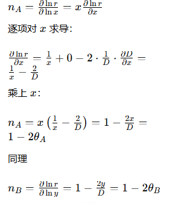

1.己烯环氧化微观动力学推导公式

$$
\boxed{
TOF=
\underbrace{\frac{k_BT}{h}
e^{-\Delta G_{\rm RDS}^{\ddagger}/k_BT}}_{\text{本征动力学}}
\cdot
\underbrace{K_{\rm C_6H_{12}}
\frac{P_{\rm C_6H_{12}}}{P^\circ}}_{\text{己烯吸附}}
\cdot
\underbrace{\theta_{\rm OOH}}_{\text{关键中间体}}
\cdot
\underbrace{\theta_*^2}_{\text{可用位点}}
}
$$

https://chatgpt.com/s/t_6adef2dfa5c48191840d3435346903eb

2.H:\catmap\Official_catmap_epoxidation\hexene_epoxidation\output_variables\mkm_job.py 修改色度条间隔方法

$$
\text{刻度间隔}=\max\left(\left\lfloor\frac{29}{n_{\mathrm{ticks}}}\right\rfloor,1\right)
$$

https://chatgpt.com/s/t_6ae004391abc8191af4be2e93670bbde

3.增加TOF DRC 相关的分析模块

https://chatgpt.com/s/t_6ae0132142108191b204f47ab0f00278

4.如果我想说明OOH物种是动力学筛选后的关键物种 我下一步电子机制中会重点分析OOH吸附能相关 的 **桥连 OOH 稳定化的电子调控机制** 这里是选择OOH 吸附能与 logTOF 高相关性还是 OOH 覆盖度与 logTOF\* 相关性 这种**逻辑过渡**有无权威文献支持？

2016 年 Physical Chemistry Chemical Physics 的原位 Raman 研究，已经在 TS-1 丙烯环氧化中观察到：骨架 Ti 物种含量、Ti–OOH 活性中间体数量和丙烯转化率之间存在正相关关系。这篇文献与你希望通过覆盖度关联催化活性来识别关键中间体的思路非常接近

https://chatgpt.com/s/t_6ae016130d048191b3b9328f22cc40ed

5.对于小论文研究内容一，核心的逻辑 判断 OOH* 究竟是重要的反应前驱体、显著控制速率的中间体，还是主要表现为表面累积物种？

具体操作输出了OOH相关动力学位点数据 https://chatgpt.com/s/t_6ae01a7468d08191b8c1efd11ba4bb1b 未成功 数据维度有误

调整绝对容差后没有解决数据维度的问题

核验失败究竟来自求根过程、数值判据，还是稳态本身不满足要求？

原因1：收敛精度与实际反应速率的数量级不匹配
https://chatgpt.com/s/t_6ae1660d52708191a9cd23346d418b97

原因2：本身的原始数据点有问题 尤其是**吸附能部分** 导致得到的TOF太小
根据官网进行了输入数据的调整

5.强化C6H12O火山关系 做出的绘图等相关调整

6.出现多次求解 同一套参数 但是TOF值是不一样的 ？

model.run()
  │
  ▼
mapper.get_coverage_map()
  │
  ├── 有缓存 (coverage_map ≠ None)?
  │     │
  │     ├── YES → 用缓存中每个点的覆盖度作为初始猜测 (c0)
  │     │         → 逐点调用 solver.get_coverage(params, c0=cached_cvg)
  │     │         → Newton 法求解稳态
  │     │
  │     └── NO  → 用 Boltzmann 覆盖度作为初始猜测
  │               → get_initial_coverage() → boltzmann_coverages()
  │               → 逐点求解
  │
  ▼
求解成功后 → 覆盖度存入 _coverage_map
  │
  ▼
model.run() 结束 → 所有 map 数据保存到 .pkl 文件
  │
  ▼
下次运行 → load_data_file() 从 .pkl 加载 → 作为缓存使用

改变参数记得删除dkl文件 影响结果

7.TOF存在负值是因为？
被消耗不是生成

8.火山图多个峰？

https://chatgpt.com/s/t_6af52eb11b788191ac73bd53082fa2bd
https://chatgpt.com/s/t_6af534b4fb848191aa1bbeddbfbfc196

参数设置问题 theshold vm.min margin 这些参数 导致一些TOF值被压缩为常数

注意到gpt帮我分析问题时候 特别冗长 难以理解
提示词：你的解释太过冗长 且不利于我以后独立发现问题 重新组织解释语言
数据核查 告诉我如何快速找到值得观察的数据 你明白吗

当前还有个问题 就是目前Jacobian 一些参数在整体框架中对应哪个部分 我非常容易看乱 导致没有理解 因此后续不知道如何调整

https://chatgpt.com/s/t_6af57233f43c8191aeaafdd31d582a5b

先用唯一的资料 建立总的知识框架 后续所有的查资料都是属于补充说明完善

需要调整反应物的量 调整峰的位置 依据官网CO氧化CO2来看 不是按照理想比例 是按照实际的实验条件

9.反应级数求导和分析问题

https://mp.weixin.qq.com/s/VePuCbIvaqaM3VTTdZaBvQ

**谐振近似** = 假设吸附物像弹簧一样来回晃，力道和位移成正比。

吸附的低频运动：就是它在表面上慢慢挪、轻轻摆。
这个动作有两个特点：
1. 晃的幅度容易比较大
2. 吸附的“束缚力”本身偏弱

弹簧模型只适合小幅度晃动。晃大了就不再是弹簧规律（非谐）。
👉 所以**低频运动不能直接套用弹簧假设，得验证一下才行**。

对比：高频振动（分子内部键伸缩）一般抖得幅度很小，弹簧假设通常够用。

