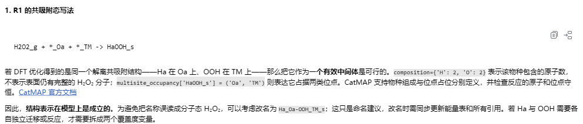

1.catmap微观动力学求解表观级数

https://mp.weixin.qq.com/s/VePuCbIvaqaM3VTTdZaBvQ?scene=1&click_id=317724623

2.火山图反着来火山中心，其中OH覆盖度过高

发现另一个问题 不能按照活性位为1 因为Ha OOH可以同时吸附在Ti-O-M上 和原来的假设每个活性位只能吸附一个原子是不一致的 这里有必要认为是多个吸附点

多位点吸附模型

一个是这个解离吸附是否是可逆的 另一个HaOOH_s解离后的共吸附态 这么写是否正确

