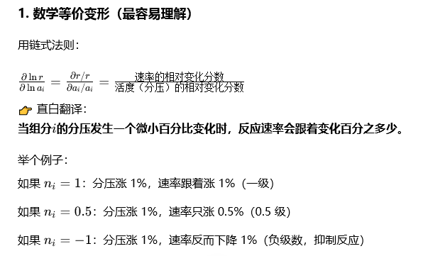
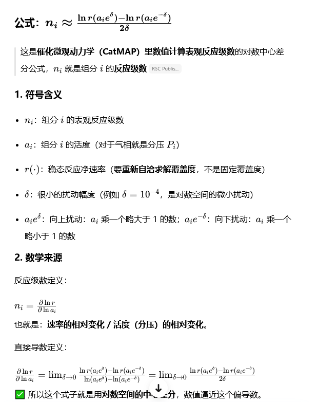
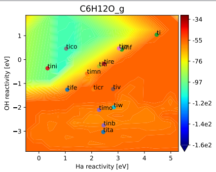
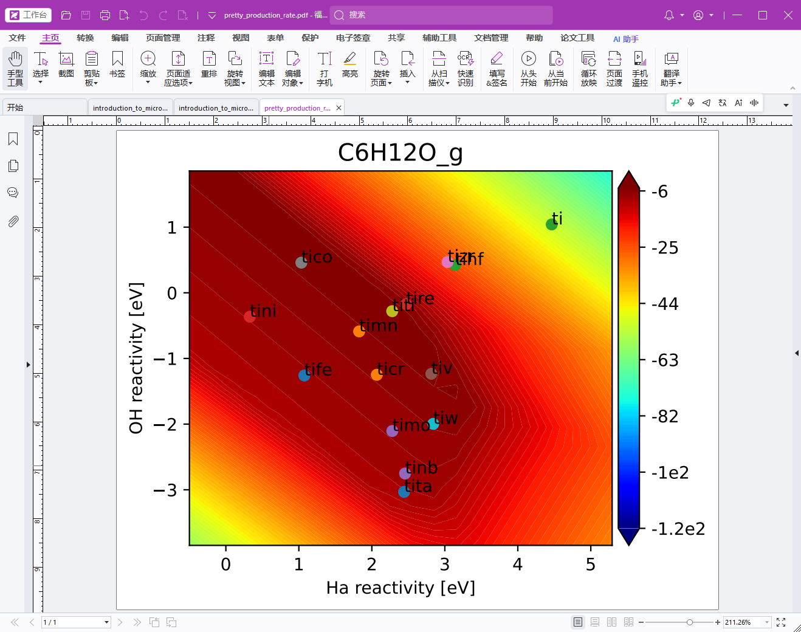

1.catmap微观动力学求解表观级数





https://mp.weixin.qq.com/s/VePuCbIvaqaM3VTTdZaBvQ?scene=1&click_id=317724623

2.火山图反着来火山中心，其中OH覆盖度过高


发现另一个问题 不能按照活性位为1 因为Ha OOH可以同时吸附在Ti-O-M上 和原来的假设每个活性位只能吸附一个原子是不一致的 这里有必要认为是多个吸附点

多位点吸附模型

一个是这个解离吸附是否是可逆的 另一个HaOOH_s解离后的共吸附态 这么写是否正确


解离吸附可逆性https://chatgpt.com/s/t_6b03f8835cd48191a75e84a895de7b90
共吸附态 当中 只能认为己烯吸附是可逆的https://chatgpt.com/s/t_6b03f8ba43ac8191aa556164ad54a292

当前考虑的多位点吸附模型
titi 活性最高 需要调整 但是火山图规范



怀疑是标度关系和catmap能量转换掩盖了原来的环氧化能垒大于氢转移能垒

我先把能量表里 R3 相关物种的实际数据读出来，确认 DFT 垒到底有没有进入模型。

我需要确认 CatMAP 对 TS 的标度回归到底怎样参数化，才能给出正确的"把 DFT 垒塞回模型"的写法。

我再确认两件事：TS 标度参数字符串的确切语法，以及 `avoid_scaling` 的默认值与生效条件。

## 一、先做一个决定性的核对：现在这张表里，R3 的 TS **不在循环顶端**

CatMAP 判谁控制速率，看的是"从最深阱（TDIS）到后续最高点（TDTS）"的跨度，而不是各步局部垒的大小。把表里的数换算到同一参考系（气体：`C6H12/H2O/H2O2 = 0`、`C6H12O = −2.089`；位点能 = 0）：

| 表面 | R3 的 IS<br>=E[HaOOH]+E[C6H12] | E[TS_R3]<br>=E[HaOOH-C6H12] | **局部垒**<br>TS−IS | 深阱 E[C6H12OHaOHb] | 深阱之后最高态 | R3 若要控制需抬高 |
|---|---|---|---|---|---|---|
| tico | −0.801 | −0.848 | **−0.047** | −1.644 | HaO-Hb：−0.607 | +0.24 eV |
| tita | −0.494 | −1.373 | **−0.879** | −2.651 | HaO-Hb：−0.257 | +1.12 eV |
| ti | +0.541 | +0.742 | +0.201 | −1.887 | Ha+OH：+3.417 | +2.68 eV |
| tinb | −0.390 | −1.173 | **−0.783** | −2.432 | Ha+OH：−0.084 | +1.09 eV |

两个硬事实：

1. **15 个表面里有 3 个（tico/tita/tinb）的 `HaOOH-C6H12` 低于它自己的反应物态**（局部垒为负）。TS 低于 IS 在物理上不可能成立 → 这一列**不是** DFT 的 R3 过渡态能量，或参考系错位（这正是本项目已知的"raw 与 converted 参考系不可混用"陷阱）。
2. 其余表面的 R3 局部垒只有 0.12–0.78 eV，而"深阱 `C6H12OHaOHb`（−1.6…−3.6 eV）之后的最高点"高出 1–5 eV → **R3 的 TS 位于深阱上游，energetic-span 原理上不可能由它控制**。

所以：改容差、改雅可比、改 DRC 流程都不会让 `HaOOH-C6H12_s` 那一列变成 +1。要让 R3 控制，必须动**能量数据 + 标度 + 机理参考态**这三层。

---

## 二、四个必须改的地方（按顺序）

### ① 数据层：先确认 `HaOOH-C6H12` 到底是什么，并补上真正的 R3 反应物复合物

表里有一列 `HaOOH-C6H12-coads`（15 个表面齐全），但**模型里根本没有这个物种**（mkm 的 `species_definitions` 只有 `HaOOH-C6H12_s`）。也就是说 DFT 的"反应物复合物 → TS"这一对里，有一个没进模型，垒的参考态自然和 DFT 图不一致。

把它接进机理，让 R3 的 IS 与 DFT 图严格对应：

```python|CODE_EDIT_BLOCK|H:\catmap\Official_catmap_epoxidation\hexene_epoxidation\2-creating_microkinetic_model\alkene_epoxidation.mkm
# ... existing code ...
    # R3：HaOOH 与己烯共吸附，越过环氧化 TS，形成产物复合态
    # Deleted:'HaOOH_s + C6H12_s + *_Ob <-> HaOOH-C6H12_s + *_Ob -> C6H12OHaOHb_s + *_TM',
    # R3a：先形成 DFT 的反应物复合物（表内已有数据，此前未入模型），保证垒的参考态一致
    'HaOOH_s + C6H12_s + *_Ob <-> HaOOH-C6H12-coads_s + *_Ob',

    # R3b：复合物越过环氧化 TS 生成产物复合态
    'HaOOH-C6H12-coads_s + *_Ob <-> HaOOH-C6H12_s -> C6H12OHaOHb_s + *_TM',

    # R4：环氧化物脱附
    'C6H12OHaOHb_s <-> C6H12O_g + HaOHb_s + *_P',
# ... existing code ...
    # R3 反应物复合物（三池 footprint 与 HaOOH+ C6H12 之和等价，位平衡自洽）
    'HaOOH-C6H12-coads_s': {
        'composition': {'C': 6, 'H': 14, 'O': 2}
    },

    # R3 过渡态
    'HaOOH-C6H12_s': {
        'composition': {'C': 6, 'H': 14, 'O': 2}
    },
# ... existing code ...
multisite_occupancy = {
    'HaOOH_s': ('Oa', 'TM'),
    'C6H12_s': ('P',),
    'HaOOH-C6H12-coads_s': ('Oa', 'TM', 'P'),
    'HaOOH-C6H12_s': ('Oa', 'TM', 'P'),
# ... existing code ...
```

> 注意：新增吸附态会改变 `adsorbate_names` 顺序 → DRC CSV/热图的列会自动多出一列，`plot_drc_options.py` 无需改；但 `multisite_occupancy` 必须同步补，否则 `model.verify()` 的位平衡检查直接报错。

### ② 标度层：`avoid_scaling` —— 让 15 个精确点**直接用表里的 DFT 能量（含 TS）**，绕开回归

这是 CatMAP 原生开关（`generalized_linear_scaler.py` L20 默认 `False`，L364-382 实现）：当传入的描述符四舍五入后命中某个表面，就把该表面**所有**吸附态/TS 的表内能量原样取用。

```python|CODE_EDIT_BLOCK|H:\catmap\Official_catmap_epoxidation\hexene_epoxidation\2-creating_microkinetic_model\alkene_epoxidation.mkm
# ... existing code ...
# ── 5. 数据文件 ──
data_file = 'alkene_epoxidation_multisite_dft.pkl'  # 隔离旧单一位点模型缓存
input_file = 'energies_dft_multisite.txt'  # 由 Excel 数据库按当前机理生成，含稳定共吸附态

# 描述符命中表内表面时直接取该表面 DFT 能量（含 TS），绕开标度回归。
# 15 个表面的 (Ha, OH) 在 2 位小数下互不重合，默认精度即可。
avoid_scaling = True
# ... existing code ...
```

代价必须写进论文：**网格点仍走回归**，所以 `production_rate.pdf` 与 `drc_exact_points.csv` 用的是两套能量。这也解释了为什么之前 DRC 的机制归属和 DFT 图对不上。

### ③ 标度层（网格也要一致时）：把 TS 的 BEP 参数**固定**，正向垒直接等于 DFT/NEB 值

源码依据：`generalized_linear_scaler.py` L185-186 —— 一旦 `params` 长度为 2，**完全不做回归**，直接用 m、b；BEP 分支 L224-243 给出的关系是

\[
E_{TS} = (1-m)E_{IS} + m E_{FS} + b \quad\Rightarrow\quad E_a^{fwd} = m\,\Delta E_{rxn} + b
\]

**取 m = 0 就是"恒定正向垒 = b"**，这才是让 R3 垒说话的正确写法：

```python|CODE_EDIT_BLOCK|H:\catmap\Official_catmap_epoxidation\hexene_epoxidation\2-creating_microkinetic_model\alkene_epoxidation.mkm
# ... existing code ...
scaling_constraint_dict = {
    'Ha_s': ['+', 0, None],
    'OH_s': [0, '+', None],
    # Deleted:'HaOOH-C6H12_s': 'BEP',
    # Deleted:'HaO-Hb_s': 'BEP',
    # BEP 参数化：E_TS = (1-m)*E_IS + m*E_FS + b，正向垒 = m*dE_rxn + b。
    # m=0 => 正向垒恒为 b（填 NEB 值），不再被 15 点回归压低。
    'HaOOH-C6H12_s': 'BEP:R3_TS',
    'HaO-Hb_s': 'BEP:R5_TS',
}

# 固定 TS 垒（eV）。走 transition_state_scaling_parameters 才能写负值，
# 因为 constraint 字符串里的 [..] 正则不允许负号。
transition_state_scaling_parameters = {
    'R3_TS': [0, 0.75],      # ← 换成 energies_dft_neb.txt 里 R3 的真实垒
    'R5_TS': [0, 0.20],      # ← R5 氢转移垒
}
# ... existing code ...
```

> 顺带修一处注释与实现不符：mkm L159 写"两个过渡态未指定模式 → 走默认 initial_state 回归"，但 L149-150 明明指定了 `'BEP'`。这句话会误导后续复现者。

### ④ 数据离群点：`tiw` 的 `C6H12 = −4.078` eV

其余 14 个表面的己烯吸附能都在 −0.04…−1.21 eV。`C6H12_s` 的标度系数由这 15 点回归，一个 −4.08 的点会把整条线拽偏 → **R3 的 IS 被人为抬高/压低，直接毁掉 R3 垒的网格行为**（tiw 的 R3 局部垒因此算出 +3.61 eV 这种荒谬值）。要么核对该行数据来源，要么在 `generate_input.py` 里剔除/单列处理。

---

## 三、先跑这个审计脚本，再决定改哪一层

它把每个基元步的**局部垒**和**相对最深阱的跨度**都算出来，直接告诉你 DFT 的"R3 最高"是哪一种口径：

```python
"""按 energies_dft_multisite.txt 复算各基元步局部垒与 energetic span。

与 CatMAP 一致：无显式 TS 的单元反应取 TS = max(IS, FS)。
运行: python step_span_audit.py
"""
from pathlib import Path
import csv

TABLE = Path(__file__).resolve().parent / 'energies_dft_multisite.txt'

# 态 = (吸附物种列表, 气体列表)；位点能量按 CatMAP 约定记 0
STATES = [
    ('S0_start',      [],                        ['H2O2', 'C6H12']),
    ('S1_HaOOH',      ['HaOOH'],                 []),
    ('S2_IS_R3',      ['HaOOH', 'C6H12'],         []),
    ('TS_R3',         ['HaOOH-C6H12'],            []),
    ('S3_prod_coads', ['C6H12OHaOHb'],            []),
    ('TS_R4',         ['C6H12OHaOHb'],            ['C6H12O'], True),
    ('S4_HaOHb',      ['HaOHb'],                  ['C6H12O']),
    ('TS_R5',         ['HaO-Hb'],                 ['C6H12O']),
    ('S5_Ha_OH',      ['Ha', 'OH'],               ['C6H12O']),
    ('S6_H2O',        ['H2O'],                    ['C6H12O']),
    ('S7_out',        [],                         ['C6H12O', 'H2O']),
]


def load():
    gas, surf = {}, {}
    with TABLE.open(encoding='utf-8-sig') as f:
        for row in csv.DictReader(f, delimiter='\t'):
            value = float(row['formation_energy'])
            if row['site_name'] == 'gas':
                gas[row['species_name']] = value
            elif row['surface_name'] not in ('None', ''):
                surf.setdefault(row['surface_name'], {})[row['species_name']] = value
    return gas, surf


def energy(state, gas, ads):
    if len(state) == 4:                      # 无显式 TS：TS = max(IS, FS)
        return max(energy(state[:3], gas, ads),
                   energy((state[1], state[2]), gas, ads))
    species, gases = state[0], state[1]
    total = sum(ads.get(sp, 0.0) for sp in species)
    return total + sum(gas.get(sp, 0.0) for sp in gases)


gas, surf = load()
header = ['surface'] + [s[0] for s in STATES] + ['Ea_R3_local', 'TDIS', 'span']
print('\t'.join(header))
for name, ads in sorted(surf.items()):
    e = [energy(s, gas, ads) for s in STATES]
    dict_e = {s[0]: v for s, v in zip(STATES, e)}
    ea_local = dict_e['TS_R3'] - dict_e['S2_IS_R3']
    wells = [v for k, v in dict_e.items() if not k.startswith('TS')]
    barriers = [v for k, v in dict_e.items() if k.startswith('TS')]
    tdis = min(wells)
    span = max(b - tdis for b in barriers)
    print('\t'.join([name] + [f'{v:.3f}' for v in e]
                    + [f'{ea_local:.3f}', f'{tdis:.3f}', f'{span:.3f}']))
```

判读规则：

- 若 `Ea_R3_local` 为负 → **数据列错位**，必须回 `generate_input.py` / Excel 数据库重取（TS 不可能低于 IS）。
- 若 `Ea_R3_local` 是各步最大、但 `TS_R3 − TDIS` 小于 `span` → DFT 的"最高"只是**局部垒口径**，CatMAP 判 R4/R5 控制与 DFT 并不矛盾；此时要改的是论文表述（同时报 `E_a^local` 与 energetic span），而不是模型。
- 若 `TS_R3 − TDIS` 确实应当最大（你手算的 DFT 绝对能高于 `HaOHb`/`Ha+OH`）→ 说明 `HaOHb`、`Ha`、`OH`、`HaO-Hb` 这一组"后半程"物种的参考系偏高，需要整列重对齐。

---

## 四、改完后的验证清单

1. **删缓存**：`alkene_epoxidation_multisite_dft.pkl` 必须删除或 `model.recalculate=True`，否则旧标度系数继续生效。
2. **看 `scaling.pdf`**：`HaOOH-C6H12` 那一格的散点-拟合线偏离就是回归造成的垒误差；开了 `avoid_scaling` 后精确点不再受它影响，但网格仍受影响 → 图上要标出哪些点是 DFT 原值。
3. **跑 `python mkm_job.py --exact-points-only`**：确认 `TOF_and_coverage.csv` 的 `coverage_C6H12OHaOHb` 是否仍 ≈1。只要它仍是静止态，R3 就不可能控制，必须回到 ①/③ 把深阱抬高或把 R3 的 TS 抬到其上方。
4. **重跑 DRC**：期望 `HaOOH-C6H12_s` 列出现接近 +1 的值；若仍为 0，说明瓶颈仍在 R4/R5，需要显式给 R4 一个 TS 物种（现在 R4 无 TS → CatMAP 用 `max(IS,FS)`，等于把 2.4 eV 的吸热量整个当成活化垒）。
5. 记得把 `HaOOH-C6H12-coads_s` 一并加进 `plot_drc_options.py` 的列分组（它是中间体，不是 TS）。
