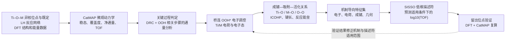

**论文逻辑思路**
https://chatgpt.com/s/t_6af71fcd63d081919bd1135c1dc8af3e

**图的叙事逻辑和回答问题**
## 新的总图逻辑

结合你补充的想法，我建议把图的主线组织为一个**从反应动力学出发、经机制解释、再到定量预测并返回验证**的闭环。三层研究内容仍然保留，但图中要明确每层的输入、判断依据和输出。

图中有两个关键判断门槛：

- **动力学门槛：** 只有稳态、通量和位点守恒检查通过，才把 TOF/DRC 用作机制和描述符的证据。
- **机制门槛：** OOH 吸附增强不能直接画成 O–O 活化增强；需要把成键变化与对应反应能垒联系起来。

## 论文结果图的排列

建议将整篇论文的结果图排成下面这条证据链。每张图回答一个问题，避免把数据库、电子结构和 SISSO 特征表堆成互不相连的结果。

### 图 1｜研究对象与反应路线

**回答：研究的是哪种位点、哪条反应路径？**

- 左侧：按实际 DFT 构型画 Ti–O–M 位点和桥连 OOH*。
- 右侧：画已确定的 1-己烯 LH 反应网络及基元步骤。
- 图底：标出数据库范围和可用数据类型，例如结构、吸附/反应能、活化能及电子结构。

结构示意应照实际计算构型绘制，尤其要画清楚 OOH* 的配位方式。若物种确为 `OOH*`，正文和图题建议用**氢过氧中间体/氢过氧基**等准确表述，避免把它和不含氢的过氧物种混称。

### 图 2｜稳态微观动力学识别关键过程

**回答：OOH 相关过程是否对整体速率有动力学影响？**

建议组合展示：

- 各 Ti–O–M 位点的稳态 TOF；
- 代表性中间体覆盖度；
- 关键步骤净通量；
- 满足稳态条件时的 DRC。

OOH 覆盖度与 TOF 的相关性可以作为辅助结果，但不要单独据此认定 OOH 控速。你贴文中提到的 `r = 0.93`、`R² = 0.87` 可作为**初步相关性**呈现；正式图中还应注明样本数、拟合范围和数据来源，并由 DRC、通量等进一步检验其动力学意义。

### 图 3｜Ti 与 M 对 OOH* 的差异化电子响应

**回答：哪个位点的电子变化与 OOH* 极化相关？**

建议做成 Ti、M、OOH 配位 O 三组并列面板，展示：

- Ti/M 电荷变化；
- OOH 配位氧电荷变化；
- 与关键电子态指标的对应关系，如经过定义的 d 带中心、自旋分辨电子态。

此图重点呈现**电子结构关联证据**。例如，M 位点电荷与 OOH 配位氧电荷的关系可以放在这里，但图注应将相关性与因果解释区分开。

### 图 4｜从电子变化到成键和活化

**回答：电子响应怎样对应 OOH* 的吸附和反应能力？**

沿 Ti–O、M–O、O–O 三种成键关系展开：

1. 电子特征与相应键的 ICOHP 或键长；
2. 成键特征与 OOH* 吸附自由能；
3. 关键成键特征与实际反应能垒。

建议在这一图里分开表达“稳定化”和“活化”：吸附自由能描述中间体稳定程度；O–O 键长、电子态和键强度反映结构/成键变化；反应能垒才用于判断相应步骤的动力学难易。若缺少某一步的过渡态能垒，就将结论限定为成键或热力学关联。

### 图 5｜机制导向的 SISSO 描述符

**回答：哪些少量物化特征可以定量描述活性？**

建议让图面直接展示：

- SISSO 输入特征如何从前面机制结果中筛选；
- 最终描述符的表达式及每项物理意义；
- 描述符与 `log10(TOF)` 的关系；
- 与简单基线的对比，例如 OOH 吸附能或单一 d 带指标；
- 训练/验证结果和误差。

此图的重点是证明描述符有预测力且有机制解释，不是只展示 SISSO 得到的公式。

### 图 6｜留出位点的预测验证与适用范围

**回答：描述符能否用于未参与建模的位点？**

用未参与 SISSO 拟合的 Ti–O–M 位点进行预测，再以 DFT 能量和 CatMAP 微观动力学复算检验。若没有实验结果，图题和结论应写“计算验证”或“理论筛选”，不写成实验发现。

## 图面叙事重点

整套图的逻辑可压缩成：

> **反应网络和稳态动力学锁定研究对象 → Ti/M 电子响应解释桥连 OOH* 的成键变化 → 成键与反应能垒连接到活性 → SISSO 提炼描述符 → 留出位点复算验证。**

这会比把“数据库、电子结构、SISSO”作为三个并列模块更有说服力，因为每张图都向下一张图提供依据。

有一个会影响论文主张的现有证据限制：项目记录中的 910 描述符运行，左峰、右峰和谷底瞬态结果均未达到稳态。因此，在这组计算完成稳态与通量验证前，不宜用它支持稳态 TOF、DRC 或稳定的活性趋势。 

## 可借鉴的论文组织方式

- *JACS* 的烯烃环氧化研究把反应动力学、热力学和光谱证据结合起来，可参考其如何从反应步骤建立机理解释。[Bregante & Flaherty, DOI: 10.1021/jacs.7b01422](https://doi.org/10.1021/jacs.7b01422)
- *Journal of Catalysis* 的 1-己烯环氧化研究连接了位点环境、表观动力学参数和过渡态稳定，可参考其怎样避免仅凭单一电子描述符解释速率差异。[Ayla et al., DOI: 10.1016/j.jcat.2022.05.013](https://doi.org/10.1016/j.jcat.2022.05.013)
- *ACS Catalysis* 的 SISSO 研究将组合描述符与单一描述符及传统关系比较，可参考其描述符验证逻辑。[Xu et al., DOI: 10.1021/acscatal.0c04170](https://doi.org/10.1021/acscatal.0c04170)

这些论文适合参考论证结构和证据组织方式；它们的催化体系与 Ti–O–M 并不相同。以上是新的论文图序逻辑，尚未写入或修改 PPT 文件。

OOH是重要中间体
https://chatgpt.com/s/t_6af7271e5d1081918aaeb2c36030f095
